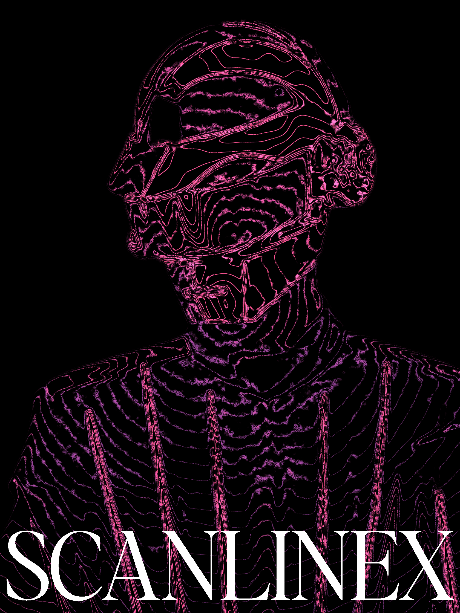

# ScanlineX

Rutt-Etra topographic scanline & scalar isoline generator for Adobe Photoshop v24.4+.



## 〰️ Features

- **Scalar Topographic Isolines:** Continuous contour fields across `Vertical`, `Horizontal`, and `Concentric Circles` modes.
- **3D Perspective Extrusion:** Camera `Pitch` / `Yaw` / `FOV` controls paired with depth-driven flow warp.
- **Local Z-Isolation:** Optional client-side Depth Anything V2 neural depth estimation and depth cutoff plane.
- **Input Levels & Auto-Normalize:** Black/white point remapping, gamma curve shaping, and auto-normalize.
- **Pixel Quantization:** Square pixel mosaic bead sampling for digital raster aesthetics.
- **Dual-Kawase Glow:** 4-level RGBA16F bloom pipeline with chromatic dispersion and analog grain.
- **Full-Res Layer Commits:** Non-destructive native resolution writeback to Photoshop as `One Layer` or `Lines + Glow`.

## ⚡ Installation & Build

- **Quick Install:** Download the `.ccx` from Releases, double-click to install via Creative Cloud Desktop, and open under `Plugins > ScanlineX`.
- **From Source:**
  ```bash
  npm install
  npm run build
  # Load dist/manifest.json in the Adobe UXP Developer Tool
  ```

## 🛠️ License

MIT License.
